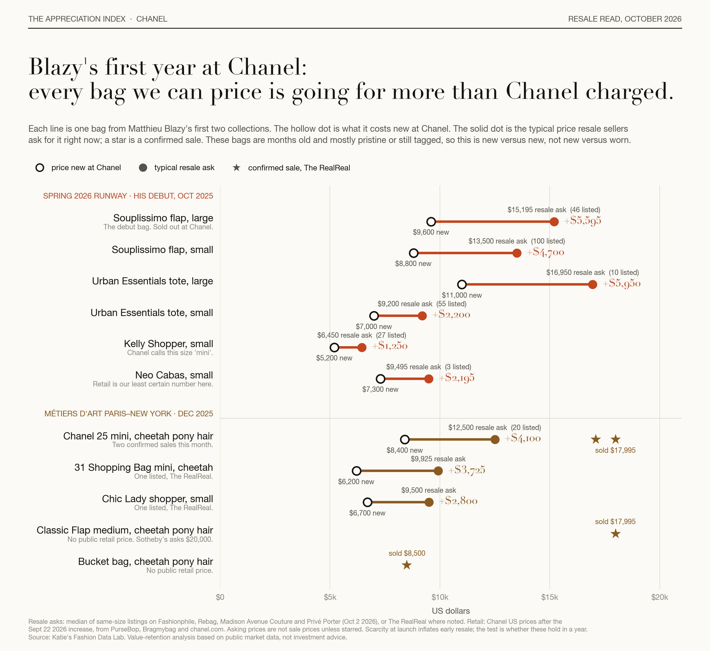
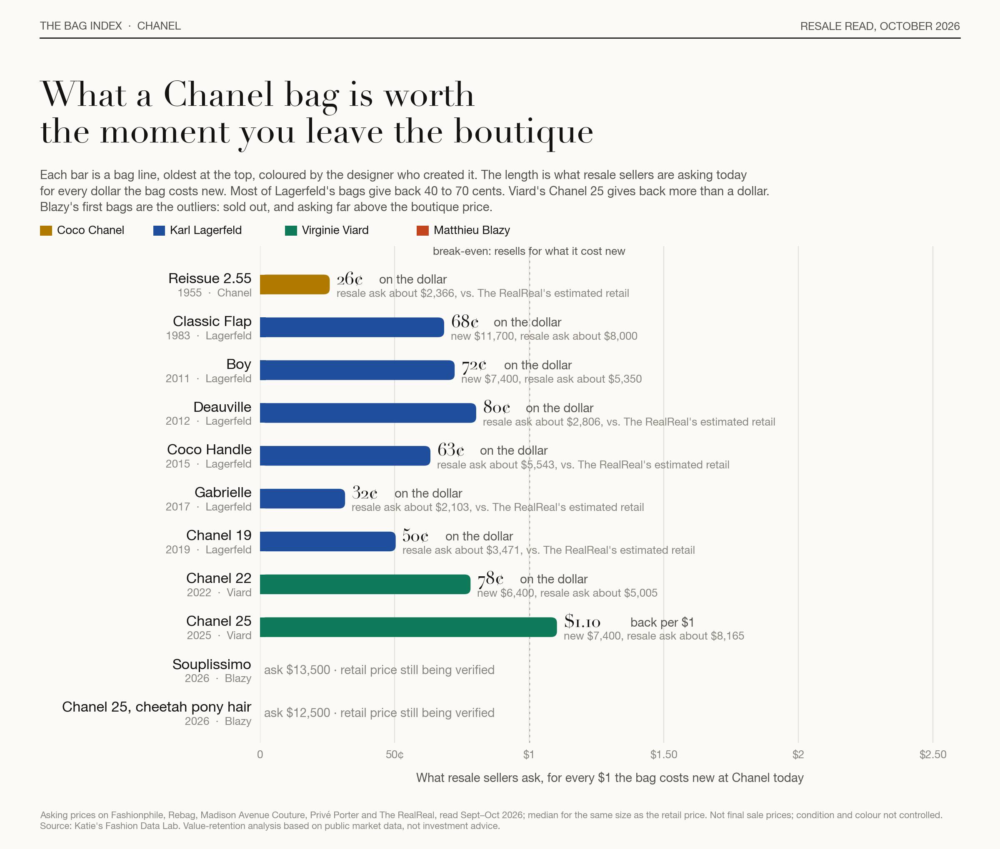
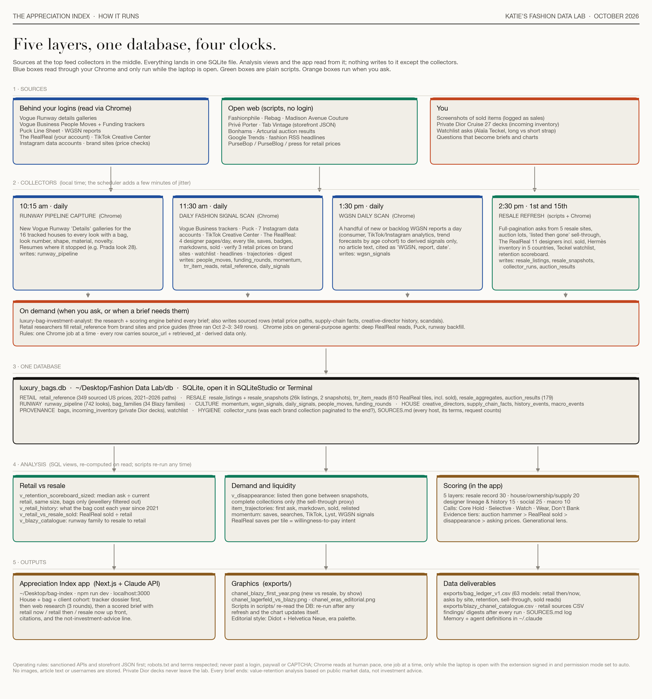

# The Appreciation Index

**Will this bag hold its value?** Ask in plain words. Get one clear answer, then the parts that matter: the money, the designer, the culture, the business, the big picture.

A value-retention intelligence tool for luxury handbags, built for shoppers, stylists and sourcers who want to know which pieces will still matter in five or ten years, and which to buy simply to wear.



## What it does

1. **You ask a question.** "Is the Chanel Souplissimo worth buying?" A small model call turns that into a structured request (house, bag, size, horizon, client type, generation).
2. **It reads its own evidence first.** A tracker database of resale listings, realised sales, sourced retail prices, runway looks, creative-director history, supply-chain facts and cultural signals is turned into a dossier before any web search happens.
3. **It researches the gaps.** Claude's server-side web search fills in what the tracker lacks, with every claim tied to a retrieved source.
4. **It scores five layers** on a transparent rubric and returns a structured brief (JSON, schema-enforced):

| Layer | Weight | What it weighs |
|---|---|---|
| Resale and auction record | 30 | Retention vs retail now and retail at purchase, sold prices, liquidity, markdowns |
| House health, ownership, supply chain | 20 | Financials, M&A, tanneries and workshops, pricing power, material scarcity |
| Creative-director lineage and history | 15 | Who designed it, era premiums, archive codes, the scandal ledger |
| Social and cultural momentum | 25 | TikTok, Instagram, search, saves, and whether the moment is durable |
| Macro | 10 | Tariffs, FX, luxury sentiment, regulation |

5. **It answers like a person.** A verdict in plain words ("Buy carefully. The version matters."), then six cards, each one idea with a "Why?" that opens the evidence. Every answer ends with the same line: *value-retention analysis based on public market data, not investment advice.*

Calls: **Core Hold** · **Selective** · **Watch** · **Wear, Don't Bank**.

## Why it exists

Creative directors are moving house at a pace the market has never seen: Blazy to Chanel, Anderson to Dior, Chiuri to Fendi, Mulier out of Alaïa. Resale platforms publish asking prices with an incentive attached. Retail prices climb every January. Nobody puts retail-then, retail-now and resale-now side by side for a specific bag and says what it means. This does.



## Architecture



- **App:** Next.js 15, TypeScript, Anthropic SDK (structured outputs via Zod, web search tool, adaptive thinking, prompt caching). Streams progress over NDJSON so a two-to-four-minute research turn survives HTTP timeouts.
- **Evidence:** a SQLite tracker (`node:sqlite`, read-only) fed by a separate data lab: Shopify storefront collectors for five resale sites, auction parsers, runway capture, and human-pace reads of sources behind the author's own logins. Collectors run on a daily and bi-weekly schedule.
- **Analysis:** SQL views for size-matched retention (median ask ÷ current retail, bags only), sell-through proxies, item trajectories, and a runway-to-resale catalogue.
- **Routes:** `/` ask box · `/api/ask` question → brief · `/classic` the full analyst form · `/api/brief` · `/briefs` library · `/brief/[id]`.

The tracker database itself is not committed. It is synced in locally with `scripts_sync_tracker.sh` and contains derived data only: no images, no article text, no usernames, no listing dumps. Every row carries a source URL and retrieval time.

## Running it

```bash
npm install
cp .env.example .env.local   # add ANTHROPIC_API_KEY
npm run build && npm run start
```

Then open http://localhost:3000. (`npm run dev` works too, but on Node 24 the production build is the reliable path; the scripts already set the flag Node 24 needs.)

Without a tracker database the app still works and says so in each brief; it simply researches from the web.

## Data ethics

- Sanctioned feeds and storefront JSON first; robots.txt and terms respected; request caps and 4–6 second spacing.
- Never past a login, paywall or CAPTCHA. Sources behind the author's subscriptions are read at human pace in her own browser and stored as derived rows only.
- Resale platforms profit from resale; their reports are cited as such. Asking prices are never presented as sales.
- Every brief is value-retention analysis based on public market data, not investment advice. Past resale performance does not guarantee future results.

## Status

v0.2, October 2026. Working end to end on a laptop; a stylist pilot is next. Built by Katie Graves (Cornell Tech MBA) with Claude.
